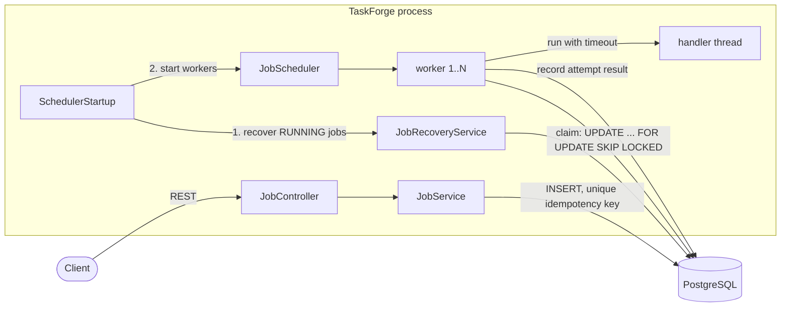
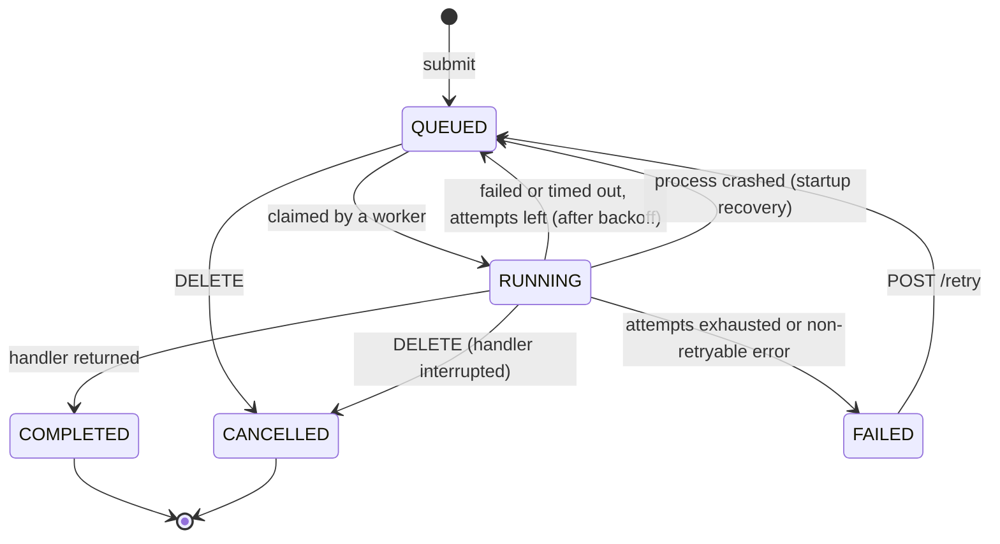

# TaskForge

A background job scheduler in Java 21 and Spring Boot, backed by PostgreSQL.
Clients submit jobs over a REST API. A pool of workers claims and runs them, with
per-job timeouts, retries with exponential backoff, cancellation of queued and
running jobs, idempotent submission and recovery from crashes.

Execution is **at least once**. The test suite proves it, including tests that
hard-kill the process mid-job and terminate database connections during a run.

## Quick start

Requirements: Docker with Compose. Nothing else is needed to run it.

```bash
docker compose up --build -d --wait   # build the image, start PostgreSQL + app
./scripts/demo.sh                     # guided tour of every feature (~1.5 min)
docker compose logs app               # structured JSON logs
docker compose down -v                # stop and delete the data
```

| URL | What |
|---|---|
| http://localhost:8080/swagger-ui.html | Interactive API documentation |
| http://localhost:8080/v3/api-docs | OpenAPI 3 document |
| http://localhost:8080/actuator/health/readiness | Readiness: database + worker pool |
| http://localhost:8080/actuator/health/liveness | Liveness: the JVM is responding |
| http://localhost:8080/actuator/info | Version, build time, Java runtime |

`./scripts/demo.sh <scenario>` runs a single scenario: `health`, `submit`,
`idempotency`, `retries`, `timeout`, `cancel` or `crash`. The `crash` scenario
kills the container with SIGKILL while a job is running and shows it being
recovered after the restart.

### Example

```bash
curl -i -X POST localhost:8080/api/jobs \
  -H 'Content-Type: application/json' \
  -H 'Idempotency-Key: report-2026-11-16' \
  -d '{"name":"Nightly sales report","type":"GENERATE_REPORT","maxAttempts":3,"timeoutSeconds":30}'

curl localhost:8080/api/jobs/<id>            # status
curl localhost:8080/api/jobs/<id>/attempts   # execution history
curl -X DELETE localhost:8080/api/jobs/<id>  # cancel
curl -X POST localhost:8080/api/jobs/<id>/retry   # one more attempt for a FAILED job
curl 'localhost:8080/api/jobs?status=FAILED'
```

## Architecture



**Submitting** inserts a `QUEUED` row. The HTTP request returns `202` without
waiting for the job.

**Workers** poll the database. Each claim is one statement: it picks the oldest
`QUEUED` job whose `available_at` has passed, locks it with `SKIP LOCKED`, sets it
to `RUNNING`, increments `attempt_count` and writes the attempt row in the same
transaction. Concurrent workers, including workers in other processes, never claim
the same row.

**Each handler runs on its own thread.** The worker waits for it in 500 ms slices,
so it can enforce the timeout and notice a cancellation requested through the
database. It then records the outcome in one transaction.

**Startup recovery** runs before any worker starts. A job left `RUNNING` was
interrupted by a crash or a kill. Its open attempt is marked `FAILED` and the job
is requeued with the normal backoff, or failed if it has no attempts left.

### Job lifecycle



Backoff after attempt *n* is `initial-delay × multiplier^(n-1)`, capped at
`max-delay` (defaults: 2 s, ×2, 5 min). An attempt interrupted by a graceful
shutdown is requeued with no delay.

### Code map

| Package | Contents |
|---|---|
| `scheduler` | `JobScheduler` (worker pool, timeouts, cancellation, shutdown), `RetryPolicy`, the `JobStore` port |
| `service` | `JobService` (submission, idempotency), `DatabaseJobStore`, `JobRecoveryService` |
| `repository` | SQL via `JdbcTemplate`: claim, finish attempt, cancel, recover |
| `controller`, `dto`, `exception` | REST API, request validation, error responses |
| `config` | Spring wiring, startup ordering, health indicator, request logging |
| `db/migration` | Flyway migrations V1–V6 |

## Operations

**Health checks.** `/actuator/health/readiness` checks the database connection and
a custom `scheduler` indicator. That indicator reports `OUT_OF_SERVICE` until
startup recovery has finished and the workers have started, and again once a
shutdown begins. The Docker `HEALTHCHECK` and `docker compose up --wait` both use
readiness.

**Structured logging.** In Compose the console log is JSON (Elastic Common Schema,
Spring Boot's built-in structured logging), one object per line. Locally it is
plain text. Every line logged while running a job carries `jobId`, `jobName` and
`attempt`, including lines written by the handler on its own thread. Every line
logged while handling a request carries `requestId`. The `requestId` is taken from
an incoming `X-Request-Id` header if it is safe, otherwise generated, and is
echoed back in the response.

```bash
docker compose logs app | grep '"jobId":"<id>"'
```

**Graceful shutdown.** `java` runs as PID 1 and receives SIGTERM directly. The
server stops accepting requests, and running jobs get 20 s to finish
(`taskforge.scheduler.shutdown-grace-period`). Compose waits 30 s before sending
SIGKILL.

**Configuration** (environment variables in `docker-compose.yml`):

| Variable | Default | Meaning |
|---|---|---|
| `TASKFORGE_WORKERS` | 4 | Worker threads |
| `TASKFORGE_PORT` | 8080 | Port published on the host |
| `TASKFORGE_DB_PASSWORD` | dev password | PostgreSQL password |

Any property in `application.properties` can be overridden the same way, for
example `TASKFORGE_RETRY_INITIALDELAY=500ms`.

## Design decisions and trade-offs

| Decision | Why | Cost |
|---|---|---|
| **PostgreSQL as the queue** (no broker) | One system to run. A job's state and history change in the same transaction as its claim, so there is no dual-write problem. | Throughput is bounded by the database, at about 4 ms of database work per job (see below). |
| **`FOR UPDATE SKIP LOCKED` claims** | Workers never block on each other or claim the same row, within or across processes. | Ordering is approximate under concurrency. |
| **Polling every 200 ms when idle** | Simple and robust to lost notifications. | Adds tens of ms of queue wait at low load. `LISTEN/NOTIFY` would remove it. |
| **At-least-once execution** | Exactly-once would need handler side effects to take part in the same transaction. | A job reruns if the process dies after the handler finished but before the commit. Handlers must be idempotent. |
| **Recovery on startup, no leases** | No heartbeat traffic, and correct for one instance. Results from a presumed-dead worker are discarded, so they cannot overwrite a newer attempt. | Startup recovery takes over **every** `RUNNING` job. With several instances, restarting one would re-run jobs that live siblings are still running. Running several instances safely needs an owner column and a lease expiry. Compose runs one instance. |
| **Idempotency through a unique constraint** | Concurrent duplicates race in the database, not in application code: one insert wins and the rest read it back. | Keys are kept forever; there is no expiry yet. |
| **Handler thread per attempt** | The worker can enforce timeouts and react to cancellation while the handler blocks. | A handler that ignores interruption keeps its (daemon) thread until it returns. |
| **No back-pressure on submission** | Submissions are cheap inserts. | Under sustained overload the queue grows without bound. |
| **Tests skipped in the Docker build** | The integration tests need a Docker daemon (Testcontainers). | CI runs them in a separate job before the image is built. |

## Testing

```bash
mvn verify                  # 97 tests, ~1 min; needs Docker for Testcontainers
mvn test -Pperformance      # benchmarks only, ~3 min
```

The integration tests run against a disposable `postgres:17-alpine` with the real
Flyway migrations. Highlights:

- **Hard kill:** the application runs in a separate JVM and is killed with
  `destroyForcibly()` mid-job. After a restart the job completes as attempt 2.
- **Connection loss:** `pg_terminate_backend` kills every connection 10 times
  during a 300-job run. Every job still ends `COMPLETED`, with a consistent
  attempt history.
- **Concurrency:** 400 concurrent submissions across 4 workers, and two scheduler
  instances sharing one database. Each job runs exactly once.
- **Idempotency:** 16 concurrent requests with one key create one job and one
  execution.
- **Split brain:** a late result from a presumed-dead instance is discarded.

[docs/testing-and-performance.md](docs/testing-and-performance.md) has the full
list of what each test proves, plus the benchmark method.

## Benchmark results

Measured through `JobService` and the real `DatabaseJobStore` against PostgreSQL 17
in Docker on the same machine (Windows 11, 16 logical CPUs, HikariCP pool of 10).
HTTP is not included. Medians of 3 runs.

| Scenario | Result |
|---|---|
| Submissions, 1 / 8 client threads | 1,957 / 12,524 per s (p99 0.63 / 1.02 ms) |
| Backlog drain, no-op jobs, 1 / 4 / 8 / 16 workers | 253 / 1,028 / 1,753 / 2,118 jobs/s |
| Backlog drain, 20 ms jobs, 1 / 4 / 8 / 16 workers | 32 / 130 / 257 / 507 jobs/s |
| Steady 50 jobs/s, 4 workers, 20 ms jobs | queue wait p50 34 ms, p99 81 ms |
| Offered 150 jobs/s, same setup | saturates at 127 jobs/s; queue wait passes 1 s |

What the numbers show:

- **Fixed cost per job is about 4 ms of database work** (claim plus result).
- **I/O-bound jobs scale almost linearly to 16 workers.**
- **No-op jobs stop scaling past 8 workers,** where workers start queuing for the
  10 pooled connections.
- **Queue wait at low load is mostly the 200 ms idle poll.**

These are single-machine figures; see the
[limits](docs/testing-and-performance.md#limits-of-these-measurements).

## CI

`.github/workflows/ci.yml` runs on every push to `main` and on every pull request:

1. **Build and test:** `mvn verify` with Testcontainers on the runner's Docker.
2. **Docker image and smoke test:** builds the image (it is not pushed), starts
   the Compose stack, waits for readiness and runs `scripts/demo.sh` against it,
   including the SIGKILL crash-recovery scenario.

## Project history

| Week | Milestone |
|---|---|
| 1 | Core Java scheduler with a worker pool |
| 2 | Spring Boot REST API |
| 3 | PostgreSQL persistence and crash recovery |
| 4 | Retries, timeouts, cancellation, idempotent submissions |
| 5 | Testcontainers integration tests and benchmarks |
| 6 | Docker, CI, health checks, structured logging, API docs |
